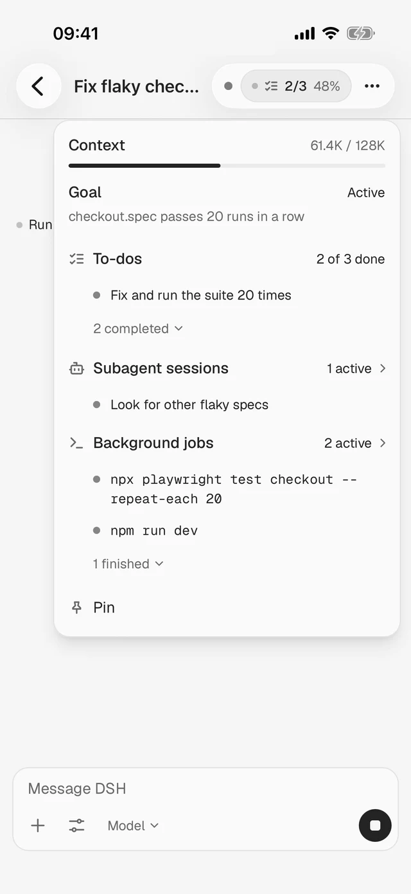
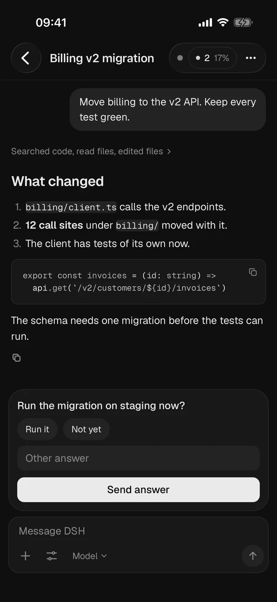

# DSH Anywhere

**The phone app for [DeepSeek Harness](https://github.com/deepseek-ai/deepseek-harness).** Your agents run on your Mac. You use them on your phone.

[Download for Android](https://github.com/jt-wang/dsh-anywhere/releases/latest/download/dsh-anywhere.apk) · [Website](https://dsh-anywhere.jingtao.io) · [中文](README.zh.md)

By Jingtao Wang ([@thejingtao](https://x.com/thejingtao))

  
  

## What you do from the phone

- See every chat, grouped by project. Start a new one in any folder on your Mac.
- Follow a reply as it arrives. Steps stay folded until you open them.
- Answer what an agent asks, approve what it wants to run, or stop it.
- Get a notification when an agent is done, stops on an error, or needs you.
- Reach your Mac from any network, with no VPN app, port forwarding or server of your own.

The agents, your keys and your subscriptions stay on the Mac.

## Get it

1. Paste this into Claude Code, Codex or DeepSeek Harness on your Mac:

   > Read https://raw.githubusercontent.com/jt-wang/dsh-anywhere/main/AGENT-INSTALL.md and install DSH Anywhere on this Mac.

2. [Download the Android app](https://github.com/jt-wang/dsh-anywhere/releases/latest/download/dsh-anywhere.apk) and install it.
3. In DSH Desktop, open **Settings → Mobile → Pair a phone**, and scan the code with the app.

To run the commands yourself, see [Set up the companion on a Mac](docs/SETUP-MAC.md).

## What a paired phone can do

A paired phone sees every chat and can run agents on your Mac. The code works once and expires. Revoke a phone at any time on the same Settings page.

## Build it yourself

It's all MIT.

- Phone app: [build and test](nsh-app/README.md#build-and-test). The iOS project builds from there too; there is no iPhone release yet.
- Mac companion: [build and install from source](docs/SETUP-MAC.md#build-and-install-from-source).

## Credits

Built on Pavel Logachev's [DSH Mobile](https://github.com/pavel-logachev/dsh-mobile) and Tailscale's [Tailcat](https://github.com/tailscale/tailcat). An unofficial app for DeepSeek Harness, not affiliated with DeepSeek.
