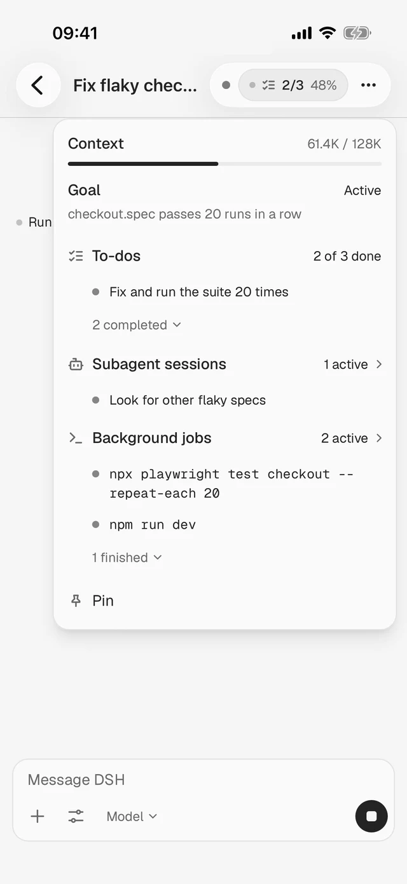
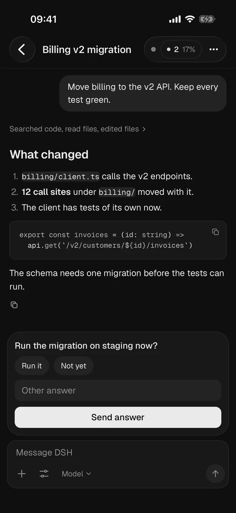

# DSH Anywhere

**[DeepSeek Harness](https://github.com/deepseek-ai/deepseek-harness) 的手机 App。** 代理在你的 Mac 上跑，你在手机上用。

[下载 Android 版](https://github.com/jt-wang/dsh-anywhere/releases/latest/download/dsh-anywhere.apk) · [官网](https://dsh-anywhere.jingtao.io/zh/) · [English](README.md)

作者：Jingtao Wang（[@thejingtao](https://x.com/thejingtao)）

  
  

## 在手机上能做什么

- 按项目看所有聊天，也能在 Mac 上任意文件夹里新建。
- 看着回复一点点出来，步骤默认折叠，点开才展开。
- 回答代理的问题，批准它要跑的操作，或者让它停下。
- 代理做完、出错停下、等你决定时，收到通知。
- 在任何网络下连回你的 Mac，不用 VPN App、端口转发或自己的服务器。

代理、密钥和订阅都留在 Mac 上。

## 怎么装

1. 把这句话贴给 Mac 上的 Claude Code、Codex 或 DeepSeek Harness：

   > Read https://raw.githubusercontent.com/jt-wang/dsh-anywhere/main/AGENT-INSTALL.md and install DSH Anywhere on this Mac.

2. [下载 Android App](https://github.com/jt-wang/dsh-anywhere/releases/latest/download/dsh-anywhere.apk) 并安装。
3. 在 DSH Desktop 里打开 **设置 → Mobile → Pair a phone**，用 App 扫码。

想自己敲命令，看 [在 Mac 上安装](docs/SETUP-MAC.zh.md)。

## 配对后手机能做什么

配对后的手机能看到所有聊天，也能在你的 Mac 上跑代理。配对码只能用一次，会过期。在同一个设置页随时可以撤销。

## 自己构建

全部是 MIT 协议。

- iPhone App：用你自己的 Apple 账号签名并安装。步骤写给你或你的编程 agent：[AGENT-IPHONE.md](AGENT-IPHONE.md)。
- Android App：[构建和测试](nsh-app/README.md#build-and-test)。
- Mac 插件：[从源码构建和安装](docs/SETUP-MAC.md#build-and-install-from-source)。

## 致谢

基于 Pavel Logachev 的 [DSH Mobile](https://github.com/pavel-logachev/dsh-mobile) 和 Tailscale 的 [Tailcat](https://github.com/tailscale/tailcat)。这是 DeepSeek Harness 的非官方 App，与 DeepSeek 无关。
